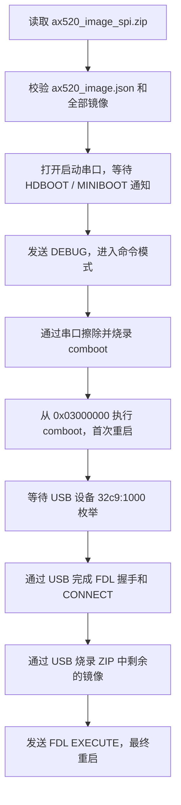

# AX520 ZIP 烧录工具

## 编译与依赖

使用 `make` 编译，生成的程序为 `build/usb_update`。编译时需要系统安装
`libusb-1.0` 开发包和 `pkg-config`；运行时需要 `unzip` 和 `jq`。

```sh
make
```

## 使用方法

连接 AX520 的启动串口和 USB 下载口，使设备进入 HDBOOT 或 MINIBOOT 模式，
然后运行：

```sh
./build/usb_update -p /dev/ttyUSB0 ax520_image_spi.zip
```

`-p` 指定启动串口设备；`-b` 可指定波特率，默认值为 `115200`。例如：

```sh
./build/usb_update -p /dev/ttyUSB0 -b 921600 ax520_image_spi.zip
```

## 烧录流程



程序会先读取 ZIP 内的 `ax520_image.json` 并校验所有镜像，然后才打开串口。
串口阶段烧录 `comboot` 并执行它；设备以 `32c9:1000` 枚举为 USB 下载设备后，
程序通过 FDL 烧录其余镜像，最后发送 `EXECUTE` 命令重启设备。
