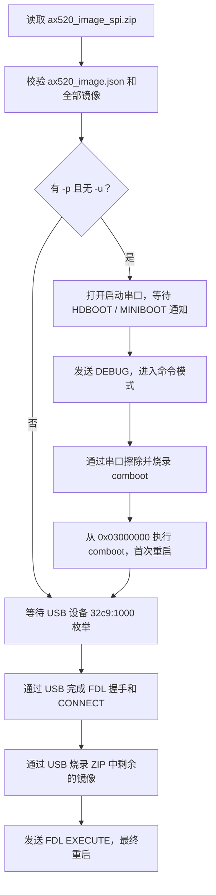
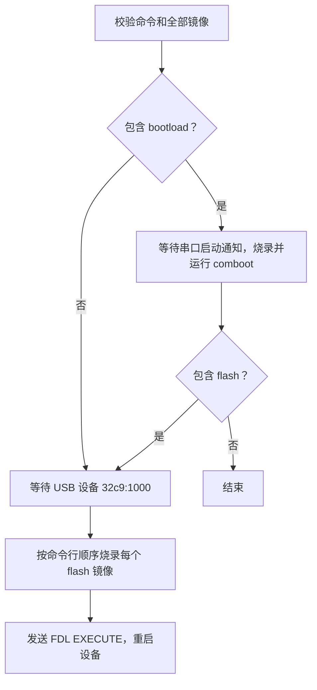

# AX520 烧录工具

## 编译与依赖

使用 `make` 编译，生成的程序为 `build/usb_update`。编译时需要系统安装
`libusb-1.0` 开发包和 `pkg-config`；ZIP 模式运行时还需要 `unzip` 和 `jq`。

```sh
make
```

## ZIP 整包烧录

如果需要先通过串口烧录 comboot，连接 AX520 的启动串口和 USB 下载口，
使设备进入 HDBOOT 或 MINIBOOT 模式，然后运行：

```sh
./build/usb_update -p /dev/ttyUSB0 ax520_image_spi.zip
```

`-p` 指定启动串口设备；`-b` 可指定波特率，默认值为 `115200`。例如：

```sh
./build/usb_update -p /dev/ttyUSB0 -b 921600 ax520_image_spi.zip
```

如果设备已经运行 comboot 并进入 USB 下载模式，省略 `-p` 即可跳过串口
bootload 阶段，直接烧录 ZIP 中除 comboot 外的镜像：

```sh
./build/usb_update ax520_image_spi.zip
```

若已提供 `-p` 但仍想跳过串口，可加 `-u` 强制仅使用 USB：

```sh
./build/usb_update -p /dev/ttyUSB0 -u ax520_image_spi.zip
```

仅使用 USB 时，`-b` 波特率不会生效。ZIP 及其中所有镜像仍会先完成校验。
程序启动时会输出所选模式，进入 USB 检测前会输出等待提示。

## 烧录流程



程序会先读取 ZIP 内的 `ax520_image.json` 并校验所有镜像。指定 `-p`
且未使用 `-u` 时，串口阶段烧录 `comboot` 并执行它；其他情况跳过该阶段。
设备以 `32c9:1000` 枚举为 USB 下载设备后，
程序通过 FDL 烧录其余镜像，最后发送 `EXECUTE` 命令重启设备。
烧录时分别显示串口 comboot、USB 数据传输和设备写入的进度条。

## 指定镜像烧录

`bootload <image>` 通过启动串口把 comboot 镜像写入 `0x03000000`，然后执行它。
该命令可以单独运行；此时程序不会等待 USB，也不会继续烧录其他镜像。
`-p` 为必填参数，`-b` 默认为 `115200`。

```sh
./build/usb_update -p /dev/ttyUSB0 bootload comboot.fimg
```

`flash <image> <start>` 通过 USB 下载口烧录镜像。设备须已进入 USB 下载模式；
`start` 是闪存映射地址，范围为 `0x03000000` 至 `0x03ffffff`。
可以在同一次调用中写多个 `flash` 命令，程序会按给定顺序烧录，最后重启设备。

```sh
./build/usb_update flash linux.uimg 0x03030000 \
  flash rootfs_ax520_64KiB.jffs2 0x03130000
```

也可以把串口引导和 USB 烧录连起来执行。`bootload` 必须位于所有 `flash` 之前：

```sh
./build/usb_update -p /dev/ttyUSB0 bootload comboot.fimg \
  flash linux.uimg 0x03030000 \
  flash rootfs_ax520_64KiB.jffs2 0x03130000
```

手动 `flash` 模式按镜像文件大小传递擦除长度，并检查镜像不会超出闪存地址范围；
不会自动检查多个镜像的地址是否重叠，请按设备分区表指定地址。


